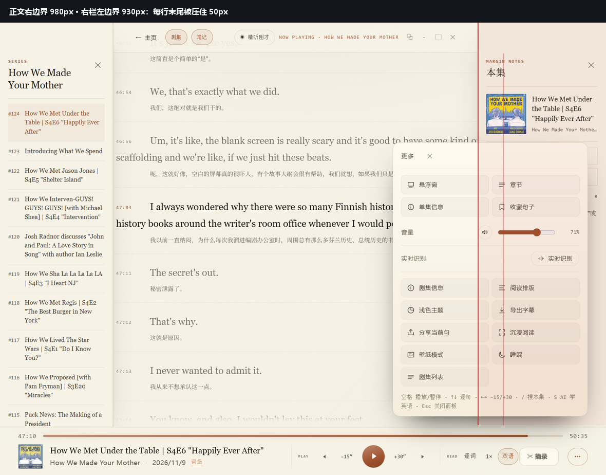
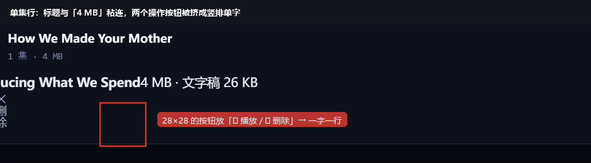
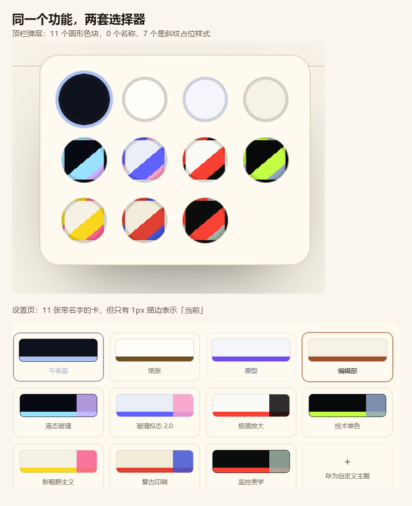
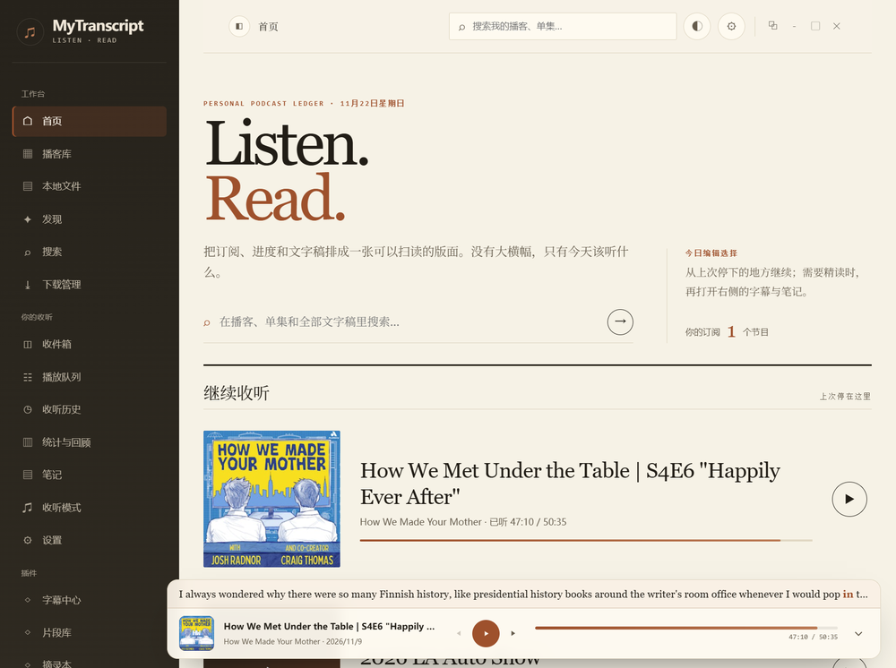
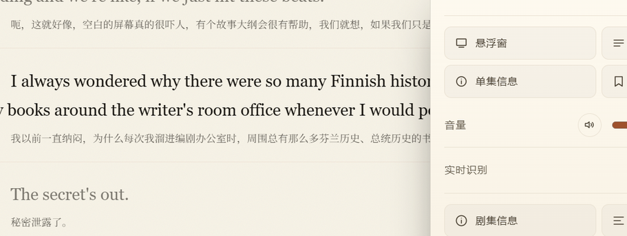
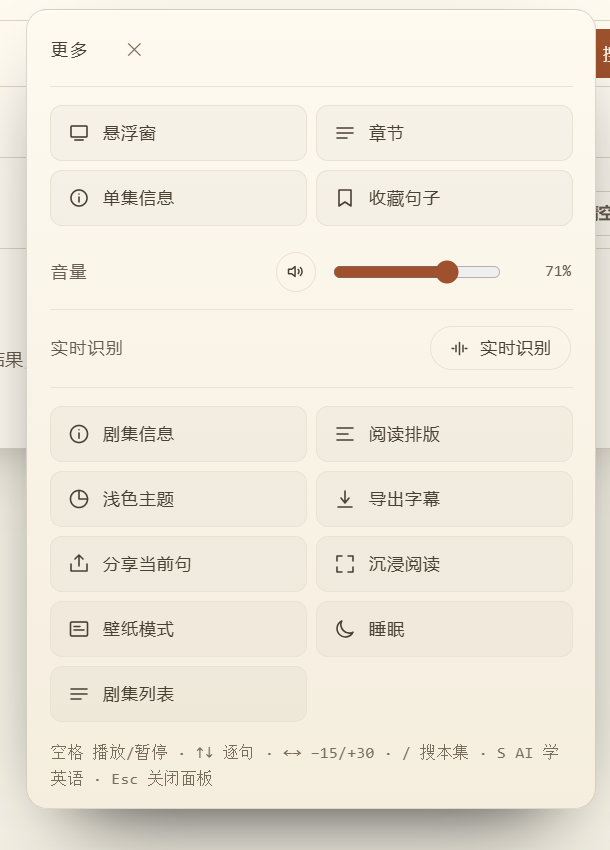
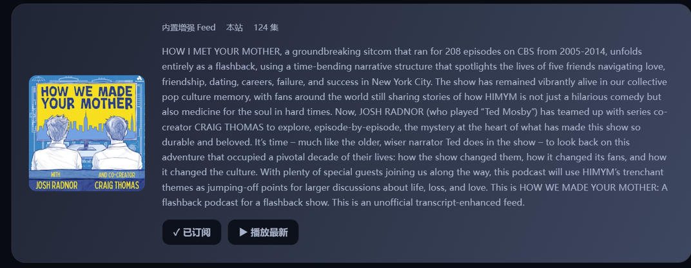

# 视觉与交互评审：MyTranscript 桌面端

- 评审日期：2026-11-22
- 评审视角：挑剔的设计师，不是测试工程师——只看"看起来对不对、读起来顺不顺、用起来体不体面"
- 环境：Windows 11 · Tauri 2 + WebView2 · 窗口 1180×880（DPR 1.5）· 真实内置源 how-we-made-your-mother（124 集，S4E6 有 908 句 / 9555 个词级时间点）
- 方法：真实启动、真实导入、真实播放；通过 WebView2 调试口读取 DOM 与计算样式，所有数字都是量出来的，不是看出来的

## 一句话结论

**骨架和气质都在，但系统没有收口。** "编辑部 / 纸张"主题下的阅读页，已经是可以拿出去见人的东西；但同一套界面里同时存在 **18 个字号、7 种按钮高度、6 种圆角、5 级近色灰**，右栏展开时正文每行末尾约 5 个字符被压住，而中文译文只有 **11.47px**。先把"读"做到无懈可击，再谈花活。

## 0. 走查范围

| 类别 | 实际走过的界面 / 状态 |
| --- | --- |
| 主框架 | 首页、播客库、本地文件、下载管理、发现、搜索、收件箱、播放队列、收听历史、统计与回顾、收藏、书签、笔记、收听模式、设置 |
| 内容 | 节目详情、单集详情、播放 / 阅读页（双语逐词）、剧集侧栏、笔记侧栏 |
| 浮层 / 窗口 | 内置源导入弹层、主题弹层、设置页主题网格、底部工具抽屉、迷你播放器、窗口控制组 |
| 插件 | 字幕中心，以及插件注入的"本集问答"卡 |
| 主题 | 午夜色（默认深色）、编辑部（首次启动默认）、纸张（浅色）三种主题下各看了一遍 |

没实测：本地文件夹导入、OPML 导入导出、实时识别、托盘右键、桌面全局字幕、11 个主题的全部切换、720–900px 窄窗（已有单独走查记录）。

## 1. P0：一眼露怯的三处

### 1.1 阅读页正文被右侧栏压住，每行末尾直接被裁



量出来的事实：

- 正文容器 `.transcript` 宽度 = 视口 1180，左右各 200 内边距 → 文本右边界 **980px**
- 右侧"本集"栏宽 250px、固定在右侧 → 左边界 **930px**
- 重叠 **50px**，每行末尾约 5 个字符被压在栏底（右栏展开时）

截图里能直接读到被裁的句子：`...it's good to have some kind o`、`...so many Finnish histor`、`...whenever I would p`。一个以"精读"为卖点的产品，正文读不全，这是最伤的一件事。

**改法**：三栏改成一份 grid，而不是三个各自 fixed 的层。

```css
.reader { display:grid; grid-template-columns:220px minmax(0,1fr) 280px; }
.reader .transcript { padding:48px 32px 70px; }
.reader .transcript .cue { max-width:720px; margin-inline:auto; }
```

右侧栏收起时，中列回到单栏居中（720–760px 行宽，才是 18.5px 正文该有的 measure）。

### 1.2 下载管理的操作按钮被挤成"一字一行"



- 单集行宽 843px，行尾两个按钮各 **28×28**，`line-height:14px`
- 文本是"▶ 播放""✕ 删除"，三个字符装不进 28px → 换行成两行单字
- 同一行的标题和体积粘连成 `Introducing What We Spend4 MB · 文字稿 26 KB`，没有分隔符

**改法**：行尾固定 96px 操作列，`white-space:nowrap`；按钮只放图标（▶ / ✕），文字进 tooltip；元信息用 `·` 分组，或 `标题（一行省略号） / 节目 · 体积 · 文字稿`。

### 1.3 主题有"两套选择器"，顶栏那套在让人猜



- 顶栏弹层：11 个圆形色块，**0 个名称、0 个当前态**；其中 7 个是斜纹块——在任何一个设计系统里，斜纹都意味着"不可用 / 占位"，这里却是可点的主题
- 设置页：11 张带名称的卡，但"当前"只靠 1px 描边，几乎看不出来

**改法**：只保留一套组件（弹层直接用设置页的卡，缩到 8 个以内）；当前态用 `✓ + accent 环`；斜纹换成真缩略——用该主题的 `--bg/--panel/--ink/--accent` 画两行字加一个按钮，一眼能看出"这个主题读起来是什么气质"。

## 2. P1：设计系统层面的四件事

### 2.1 字号是散点，不是阶梯

在 8 个主页面里实测到 **18 个不同字号**：`9 / 9.5 / 10 / 10.5 / 11 / 11.5 / 12 / 12.5 / 13 / 14 / 15 / 16 / 18 / 19 / 22 / 26 / 28 / 82.6`。

- 9 到 12.5 之间塞了 **8 档**，差 0.5px 的两档在屏幕上根本分不出来，只会让排版显得"没对齐"
- 阅读页单页就有 13 档：`8.5 / 9 / 9.5 / 10 / 10.5 / 11 / 11.47 / 11.5 / 12 / 12.5 / 13.5 / 18.5 / 20`
- 9px 文本在节目页出现 **127 次**（徽章 / 角标）

**改法**：8 级阶梯 + 硬下限 11px。

| Token | 值 | 用途 |
| --- | --- | --- |
| `--fs-micro` | 11px / 1.4 | 角标、时间码、眉标（不许再小） |
| `--fs-caption` | 12.5px / 1.5 | 元信息 |
| `--fs-small` | 13.5px / 1.6 | 说明文字 |
| `--fs-body` | 15px / 1.65 | 正文、列表 |
| `--fs-lead` | 17px / 1.6 | 摘要、问答 |
| `--fs-h3` | 20px / 1.3 | 区块标题 |
| `--fs-h2` | 26px / 1.2 | 页面标题 |
| `--fs-display` | 44 / 64px | 首页主视觉（二选一，不要 82.6） |

顺带：`11.47px` 这种值是缩放算出来的，不该出现在成品里。

### 2.2 品牌断层：首页是 Georgia 82.6，内页是 system-ui 26/800

- 首页 h1：**Georgia 82.6px / 400**，衬线、文学气
- 所有内页 h1：**system-ui 26px / 800**，黑体、很重、很"后台"

这不是"两种语气"，这是两个产品。首页说"Listen. Read."，点进去变成"设置面板"。

**改法**（二选一，别混）：

- A. 内页也走 `--serif`，h1 34–38px / 500，佐以 mono 眉标 → 一致的"编辑部"性格
- B. 统一走 sans，但把首页压到 56/44，标题字重降到 700，并给首页配同样的 12px 眉标格式

我倾向 A：这套衬线排版是这个产品最贵的资产，内页丢掉太可惜。

### 2.3 五级近色灰，层级反而消失了

午夜蓝主题下实测对比度（对 `--bg`）：

| Token | 色值 | 对比度 | 判断 |
| --- | --- | --- | --- |
| `--ink` | #e9edf5 | 16.8 | 正文 |
| `--soft` | #c3cde0 | 12.3 | 与 ink 几乎同级 |
| `--muted` | #a6b2c8 | 9.2 | 说明 |
| `--meta` | #a3aec2 | 8.8 | 和 muted 差 3% |
| `--dim` | #7c89a3 | 5.6 | 勉强过 AA |

五个层级、四种"灰"，用户读不出"哪个更重要"，只读到"一片灰"。

**改法**：收敛到 3 档 —— `ink`（正文）/ `muted`（次要，目标 6.5:1）/ `faint`（装饰，仅用于 ≥11px 且非关键信息）。`soft / meta / dim` 合并。

### 2.4 形状没有规矩：7 种按钮高度、6 种圆角

- 控制类按钮高度实测：**26 / 28 / 30 / 33 / 34 / 40 / 46**（另有 81 / 83 / 130 的卡片式按钮）
- 圆角实测：**8 / 10 / 11 / 13 / 50% / 999**（卡片另有 16）
- 同屏出现：搜索页一个 26px 的搜索按钮、34px 的筛选按钮、999px 的话题 chip

**改法**：

| 角色 | 高度 | 圆角 |
| --- | --- | --- |
| 小控件 / chip | 28 | 999 |
| 常规按钮 | 36 | 10 |
| 页面主按钮 | 44 | 10 |
| 卡片 | — | 14 |
| 输入框 | 40 | 10 |

只允许"三高一圆"存在；其余数值从代码里删掉。

### 2.5 图标是一套 Unicode 字符，光学尺寸不齐

侧栏、顶栏、底栏、工具抽屉的图标全部是字符：`⌂ ▦ ▤ ⤓ ✦ ⌕ ◫ ☷ ◷ ▥ ★ ☆ ♫ ⚙ ◐ ◧ ⟳ ✂ ⋯ ◇`。它们来自不同字体区块，笔画粗细、视觉重心、字面大小都不一致：

- `⌕` 和 `⚙` 放在同一行，一个像细线一个像实心
- `◧`（侧栏收起）和窗口的 `▤` 几乎同形，语义却完全不同
- `◇` 作为插件图标重复出现三次，无法区分插件

**改法**：先做 20 个 SVG（24×24，1.5px stroke，统一的圆角半径），优先替换 **侧栏导航 / 窗口控制 / 底栏播放** 三组。字符图标可以留作彩蛋，但不能承担导航。

## 3. P1：页面级的七个问题

### 3.1 首页在自我否定：文案说"没有大横幅"，画面就是一个 352px 的大横幅



- 主视觉块高 **352px**，底边在 482px；"继续收听"标题在 **507px**，正文卡片基本落在首屏之外
- 文案原句："没有大横幅，只有今天该听什么"——画面上最大的东西就是横幅
- 同屏两个搜索框：顶栏"搜索我的播客、单集…"、首屏"在播客、单集和全部文字稿里搜索…"，能力不同但外观几乎一样，用户不知道该用哪个
- 右侧"今日编辑选择"配了一根装饰性竖线，长度与内容无关——纯装饰却抢注意力

**改法**：主视觉压到 1/3 屏（h1 56/44，搜索只留一个并兼任全局搜索）；"继续收听"上提到首屏上半部；竖线要么去掉，要么与内容等高。

### 3.2 阅读页：英文是主角，中文是脚注——中文只有 11.47px



量出来的事实（纸张主题）：

| 元素 | 字号 | 行高 | 字体栈实际落点 |
| --- | --- | --- | --- |
| 英文正文 | 18.5px | 32.93px（1.78） | Georgia |
| 中文译文 | **11.47px** | 19.73px（1.72） | Georgia → 中文回退宋体 |
| 句首时间码 | **9.5px** | — | 52% 不透明度（对米色底约 3.4:1，不到 AA） |

- 中文与英文的字号比 **0.62**，视觉上中文就是一行脚注；再叠上宋体回退，笔画又细又小
- 每条中文都带 `margin-left:66px` 的内联缩进，行长被压到 688px，短句显得零碎
- 每行左侧 9.5px 时间码 ×240 条，形成一条很淡但连续的"数字噪点"
- 每句还内嵌一个 **"精听" 按钮 ×240**：`opacity:0`、`pointer-events:none`，但 `tabIndex=0`——键盘用户要 Tab 过 240 个看不见的按钮

对一个中文用户，"双语精读"里中文至少该和英文同等重要。

**改法**：中文 **15px / 1.85**，与英文间距 8px，字体栈显式加 `"Microsoft YaHei"`；提供"中文优先"预设（中文 17px + 英文 15px）；时间码默认只在 hover 与当前句显示，其余降到 8% 不透明度；"精听"按句焦点出现（`tabindex=-1`，只在 cue 被 focus/hover 时激活）。

### 3.3 工具箱是杂物抽屉：11 个等权按钮，还自己重复自己



- 11 个按钮，全部同样的尺寸、同样的灰、同样的圆角 → 没有主次
- **"单集信息" 和 "剧集信息" 同时存在**；**"章节" 和 "剧集列表"** 语义重叠
- "浅色主题" 与设置页的"外观与主题"是同一个能力的两种叫法
- 底部快捷键图例 11px、两行、用 `·` 和 `/` 混排，读起来像脚注

**改法**：分四组（播放 / 视图 / AI / 系统），每组最多 4 项；合并重复项；快捷键图例做成可展开的 `?`。抽屉里最多 2 个主按钮。

### 3.4 迷你窗不继承主题，标题栏只剩一个"字"


- 主窗切到"编辑部/纸张"，迷你窗仍然是深色——两个窗口像两个 App
- 标题栏中间显示一个孤零零的 **"字"**（标题被截断到只剩一个字），没有"迷你播放器"之类的名称
- 步长 **−5s / +5s**，主播放器是 **−15s / +30s**
- 尺寸实测 344×188，README 写的是 344×132（已过期）

**改法**：迷你窗读同一份主题 token；标题栏显示应用名；步长跟主窗共用一份 `prefs`；补 12px 内边距。

### 3.5 节目页：一段约 100 字符/行的简介，把操作按钮推到下半屏



- 简介 15px 衬线，行宽约 1030px ≈ **100 字符/行**，连读三行就串行
- "已订阅" 和 "播放最新" 两个按钮同尺寸同色，主操作没有站出来
- 元信息 `内置增强 Feed 本站 124 集` 三段挤在一行，没有分隔
- 右卡"节目资料"里放了一个 **"加载全部单集"** 按钮——列表的控制长在了资料卡上

**改法**：简介限宽 68ch、默认 3 行 + "展开"；"播放最新"给 accent 实心，"已订阅"降为描边；"加载全部单集"移回"单集"卡的表头（和 `最近 20 / 124` 同一行）。

### 3.6 单集页：9 个动作按钮平铺，标题却不是单集名

- 页面 h1 = 节目名（`How We Made Your Mother`），真正的单集标题被放到下面 32px 的卡片里——层级反了
- 动作按钮 9 个：播放单集 / 队列 / 收藏 / 已听 / 列表 / 整集下载 / 复制链接 / 片段 / 返回节目，全部同尺寸、同一灰底
- 播放按钮旁边紧挨着"本集问答"的"检索原话 / AI 回答"两个浅色主按钮，全页一共 **11 个按钮**，主操作仍然不突出

**改法**：h1 用单集名，节目名做面包屑；主操作 2 个（播放 / 下载）+ "更多"菜单；问答卡的两个按钮合成"提问"，"检索原话"作为空态建议。

### 3.7 弹层：打开瞬间，焦点把"关闭"变成全场最重的按钮

- 内置源弹层打开后 `document.activeElement` 就是那个 **28×28 的 ✕**，2px accent 焦点环 + 2px offset 让它成为整屏唯一"带环"的元素，重量盖过主操作
- 真正的主操作"导入所选"只是 44px 的浅色实心，视觉重量被压过去
- 列表滚动区的最后一行被固定页脚压住，没有渐隐、没有内边距，像被裁掉

**改法**：焦点落到弹层容器或第一个可选项（`role=dialog` + `tabindex=-1`），`✕` 保持 32px 无边框；页脚加 12px 上分隔与 16px 内边距；列表底部留出页脚高度。

## 4. P2：打磨清单

| # | 问题 | 证据 | 一句话改法 |
| --- | --- | --- | --- |
| 1 | 每个页面都有装饰性英文眉标（`YOUR COLLECTION` / `LISTENING STATS` / `UP NEXT`） | 8 个页面同款 | 删掉，或换成有信息量的状态行（`124 集 · 2 小时前同步`） |
| 2 | 发现页同屏 3 个搜索框 + 4 个筛选控件 | 在线搜索 / 本站搜索 / 顶栏搜索 | 站点检索只留一个入口，筛选收进一行 |
| 3 | 统计页叫"年度回顾"，页面上没有年度内容 | 3 张数字卡 + 两张条形图 | 要么补年度卡，要么改名"收听统计" |
| 4 | 队列行只有序号 + ✕，没有排序/拖拽 | 单行卡，序号 `01` 是 12px 等宽 | 加 drag handle；序号改为"第 1 首 / 共 1 首" |
| 5 | 播放器顶栏 `NOW PLAYING · HOW WE MADE YOUR MOTHER` 10px 全大写 | 浅色主题下对比很低 | 改成 12px 常规大小写，或只留一个状态点 |
| 6 | 进度条 2px、无 hover、无拖拽柄 | 全站一致 | hover 时加到 4px 并出现 12px 圆柄；拖拽时显示时间气泡 |
| 7 | 设置行控件高度不一：开关 20、选择框 40、按钮 34 | 播放设置页 | 统一 36；开关与选择框右边缘对齐 |
| 8 | 收听历史的 2px 进度线横贯 1120px，像分隔线 | 7 行列表 | 进度线缩到 240px，或改成环形/百分比 |
| 9 | 空态卡高度写死，库/下载/队列/笔记底部留 300–500px 空白 | 4 个页面 | 空态卡 `min-height:160px`，内容垂直居中，给一个主 CTA |
| 10 | 模态 / 抽屉的标题、正文、按钮三处都用了不同的字重与字号 | 内置源弹层、工具抽屉 | 全站统一"标题 20/700、正文 15/400、按钮 14/600" |

## 5. 值得保留的（别在重构里弄丢）

1. **编辑部 / 纸张主题的阅读页**：衬线正文 + 衬线侧栏 + 米色底，是这套产品里唯一"有作者"的画面。
2. **逐词高亮 + 自动跟随**：当前词是一枚带衬线的浅色胶囊，克制、准确。
3. **侧栏 `SERIES` 的编辑式排版**：大标题压小序号，信息密度高但不吵。
4. **主题 token 化 + 自定义 CSS**：11 个主题、每个都能改 `--bg/--accent`，这是可扩展的正确姿势。
5. **焦点环统一**：`2px var(--accent)`，键盘可达性没有掉队。

## 6. 建议的三批改动

**Batch 1 · 结构修复（约半天）**
1. 阅读页三栏改 grid，正文回到 720–760px measure（P0-1.1）
2. 下载行行尾固定 96px 操作列 + `nowrap`（P0-1.2）
3. 主题选择器合并成一套，加当前态（P0-1.3）

**Batch 2 · 系统收口（约一天）**
4. 字号 8 级阶梯、灰阶 3 档、圆角/高度各 3 档，写进 `player.css` 顶部 token 区
5. 20 个 SVG 图标替换导航 / 窗口控制 / 播放三组
6. 首页与内页统一 h1 语言（建议 serif）

**Batch 3 · 页面重排（1–2 天）**
7. 首页压缩主视觉、合并搜索、上提"继续收听"
8. 节目页 / 单集页的层级与按钮分组
9. 工具箱分组 + 迷你窗继承主题和步长
10. 空态与列表密度统一

## 7. 证据与清理说明

- 截图与标注都在 `docs/design-critique-assets/`，数值来自 WebView2 调试口的 `getBoundingClientRect` / `getComputedStyle`。
- 为看到真实内容，临时导入了内置源 `how-we-made-your-mother`，评审结束后已取消订阅（订阅数回到 0）。
- 主题临时切到过"编辑部 / 纸张"，评审结束后已切回原来的"午夜蓝"，并恢复了此前的自定义主题 CSS（15,023 字节，`enabled=true`）。
- 没有修改任何源码、没有 commit、没有 push。
