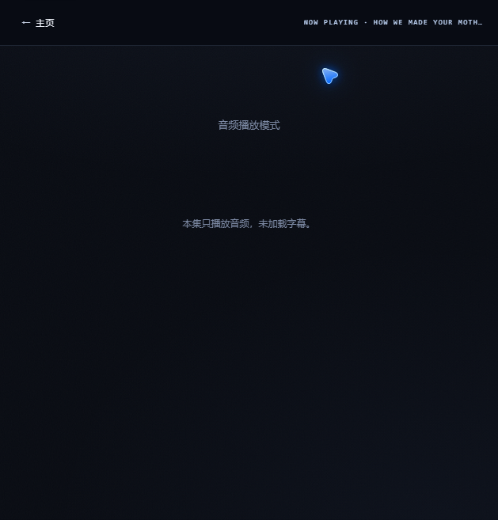
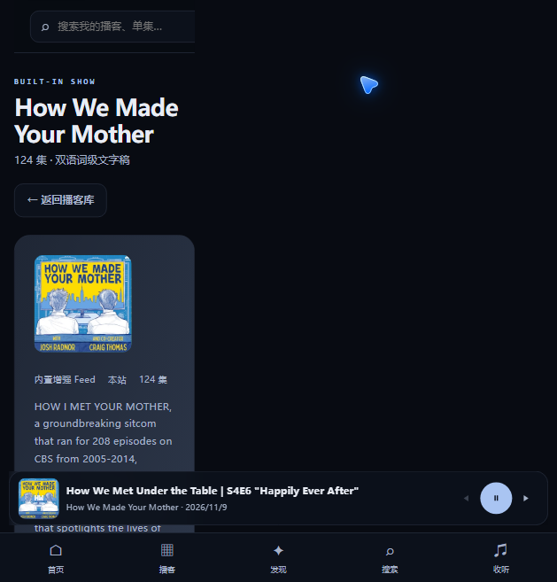
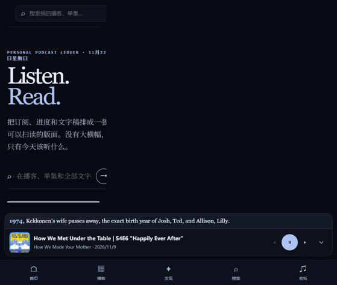
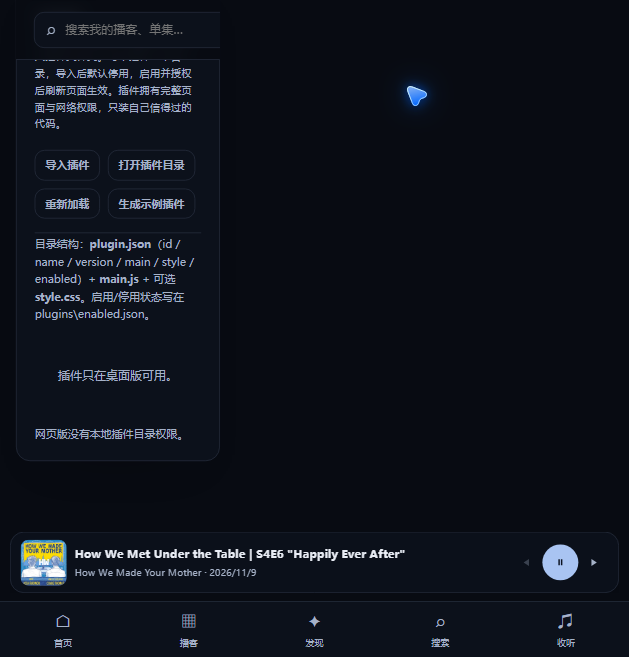
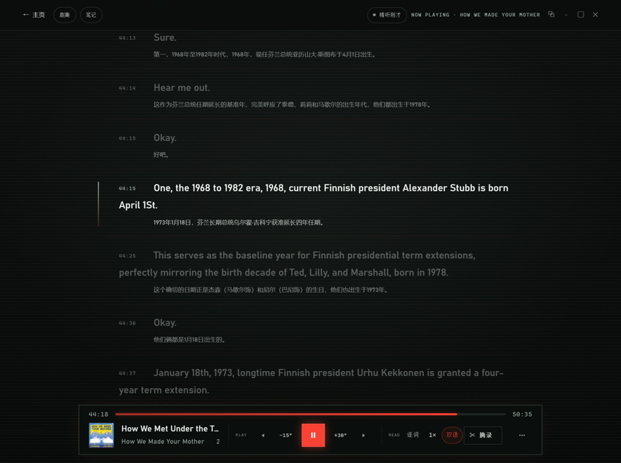
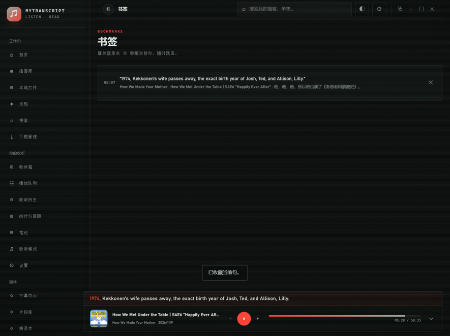
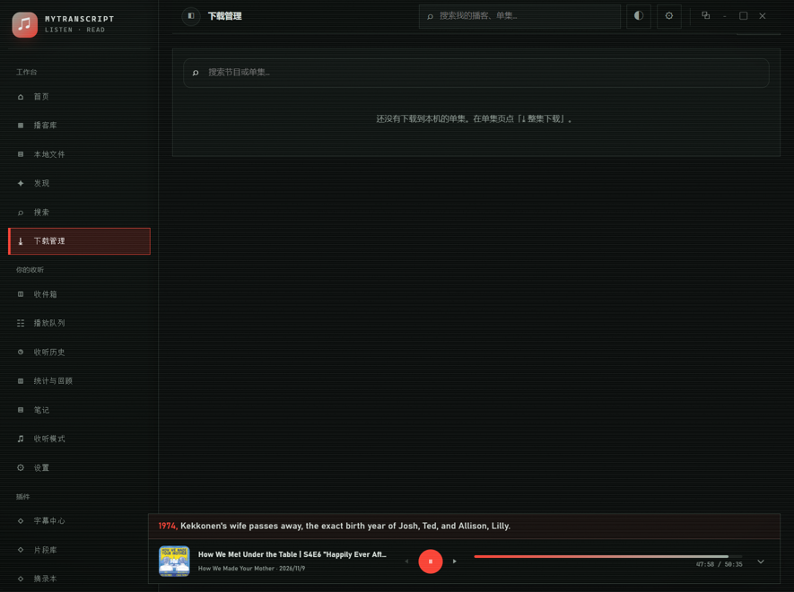

# MyTranscript 普通用户走查报告

- 走查日期：2026-11-22
- 走查对象：Windows/Tauri 桌面壳 + GitHub Pages 网页播放器（共用同一份 `site` 静态站）
- 走查身份：第一次使用的普通听众，不预设立场，不读源码操作
- 走查方式：真实点击、真实导入、真实播放、真实保存、真实下载；桌面端另开远程调试抓取 DOM 复核
- 结论：**主链路能跑通，精校文字稿的体验有竞争力；但"网页端没有字幕却宣传 100% 覆盖"、"窄窗直接塌成一条竖栏"、"中文译文整段错位"三件事会直接摧毁新用户信任，必须在对外推广前修掉。**

## 修复状态（2026-11-22 晚）

按 `/goal` 的顺序修复，全部改动留在工作区，**未提交**。

| 项 | 状态 | 实测 |
| --- | --- | --- |
| P0-1 网页能力与文案一致 | 已修 | 网页 629px 节目页只写"网页版仅音频（桌面版支持字幕）"，不再显示覆盖率；单集页无"整集下载/AI 总结"；字幕语言与排版控件在网页隐藏 |
| P0-2 窄屏重排 | 已修 | 网页 629/746/1180、桌面 746×632 均满宽无横向溢出；窄屏侧栏收起、底栏 6 个入口、"更多"抽屉可开可关 |
| P0-3 中英按时间对齐 | 已修 | 桌面真实 hwmym S4E6：44:14 `Hear me out.` → `听我解释。`，44:15 `Okay.` → `好吧。`，44:52 `They were both born on January 18th.` → `他们俩都是1月18日出生的。` |
| P1-1 下载状态 | 已修 | 桌面真实下载 69MB 单集：下载页即时显示"下载中 0% · 8 KB / 69 MB"，12 秒后变"1% · 714 KB"；完成后不重启即出现在已完成列表 |
| P1-2 续播首屏 | 已修 | 保存进度 43:41 后重开单集，首屏直接落在 43:24–43:41 区段，不再从 00:00 铺全量 |
| P1-4 中文问答 | 已修 | "芬兰总统是谁"返回 44:15/44:25/46:05 等中英对照原话；未配 Key 时的按钮可直达"设置 → AI 学英语" |

两个实现细节值得记住：

- 桌面字幕插件从 `C:\ProgramData\MyTranscript\plugins\subtitles` 读取，不是仓库 `builtin-plugins`；改完源码必须同步安装目录，App 才会加载新 `kernel.js`。插件文件变化会触发重新授权。
- `build.rs` 之前只监听 `vendor/sherpa`，内置插件与 `site` 改动不会让 Tauri 重新打包资源；已补 `rerun-if-changed`，避免再次出现"代码改了、App 还是旧版"。

AI 作答本身在本机被网络拦截（`api.openai.com` 请求失败），所以验收的是"配置识别 + 中文检索 + 空配置入口"；模型回包未能在本次环境验证。

## 0. 先说结论

按"普通用户会不会因此放弃/投诉/误操作"排序，最痛的 5 件事是：

1. **网页版没有字幕，却到处写"双语词级文字稿 100% 覆盖"。** 点进播放器只有"音频播放模式"，右侧还摆着"字幕语言 EN/中文/双语/按句拆"四个无效控件。
2. **窗口一窄就崩。** 桌面 746px、网页 629px 下，顶栏控件叠进搜索框，正文挤成 200–340px 窄条，逐 3 个词换行，10 个导航页彻底不可达。
3. **中文译文和英文句子对不上。** 44:14 的 "Hear me out." 下面挂着 44:25 的译文，44:36 的 "Okay." 下面是"他们俩都是1月18日出生的"，书签里 1974 年的句子配《老爸老妈浪漫史》台词。
4. **"实时识别"一键就把精校稿换成地板级 ASR。** 没有确认、没有对比、没有"仅预览"，先看到的是 "kekkanen / kobe ro / tarran b"。
5. **整集下载完成了，界面却一直当它没下。** 实际 5 分钟下完 71.9MB，下载页在会话内仍空态，重启后才出现；期间进度在 25%/75% 之间跳，没有完成、失败、取消、重试。

## 1. 覆盖范围

| 端 | 已实际操作 |
| --- | --- |
| 桌面 1180×880 | 首页、播客库、节目页、单集详情、播放器、阅读页、发现、搜索、下载管理、队列、历史、统计、笔记、书签、收听模式、设置、插件、字幕中心 |
| 桌面 746×632 | 首页、播客库、播放器、设置、插件、工具面板、迷你窗 |
| 网页 629×657 | 首页、播客库、发现、搜索、节目页、单集、播放器、笔记、书签、设置、主题切换、Add RSS |
| 共用能力 | 内置源导入、OPML 导出、英文搜索、中文问答、书签/笔记、双语切换、字号/行距/宽度、睡眠定时、实时识别、整集下载、订阅删除、主题切换 |

未实测：本地文件夹导入（原生对话框）、OPML 导入、CORS 代理校验、桌面全局字幕（托盘实验项）、托盘右键实际操作、导出字幕的系统保存对话框、断网状态下的离线播放、订阅自动刷新跨进程。

## 2. P0：会直接让用户不信任的问题

### P0-1 网页端没有字幕，但全站宣传"100% 双语词级覆盖"

**现象**

- 网页节目页写"124 集 · 124/124 · 双语词级文字稿 100% 覆盖"。
- 点进网页播放器，正文位置写"音频播放模式 / 本集只播放音频，未加载字幕"。
- 右侧"阅读排版"仍提供"字幕语言：EN / 中文 / 双语 / 按句拆"，点了没有任何效果。
- 网页设置里又写"插件只在桌面版可用""网页版没有本地插件目录权限"。

**复现**

1. 打开 `https://lzoreal.github.io/MyTranscript/player.html`。
2. 导入内置源 `how-we-made-your-mother`。
3. 进入节目页→最新单集→播放。
4. 观察播放器正文与右侧排版面板。

**影响**

这是产品最强的差异化卖点。新用户看到"100% 覆盖"进来，第一眼却是"未加载字幕"，会直接判断"虚假宣传/坏了"。右侧无效控件进一步坐实"这站没人测过"。

**根因线索**

- 浏览器没有 Tauri 宿主，`LIVE_HOST` 为 null：`site/player/00-runtime.js:55-60`。
- 本地音频插件因此不加载：`site/player/04-local-audio-plugin-host.js:1883` 的 `if (!host()) return`。
- 字幕层在插件关闭时写死音频模式：`site/player/12-subtitle.js:185-192`。
- 宣传口径来自 `src/player-js/07-routes-pages.js:224`（"双语词级文字稿"）与 `:1062`（"站外节目仅音频"）。
- 网页"插件只在桌面版可用"：`src/player-js/04-local-audio-plugin-host.js:2042`；静态页同段文案在 `site/player.html:337`。

**建议**

- 产品层二选一，不要混着说：
  - A. 网页版明确降级：所有"100% 覆盖"改成"桌面版支持双语词级字幕；网页版仅音频"，隐藏字幕语言/按句拆控件，播放器顶部加一条说明和"下载桌面版"入口。
  - B. 网页版补能力：既然 `json/<slug>/` 已有双语词级数据，网页端直接拉 JSON 渲染只读字幕，不依赖 Tauri 插件。这条更能兑现承诺，但要处理跨域、体积与首屏。
- 不论选哪条，先做 **能力探测**：`hasHost ? 全套 : 音频模式`，UI 文案和控件都从同一处能力开关渲染，避免"文案说有、界面没有"。

### P0-2 窄窗/内置主题下布局塌陷，导航不可达

**现象**

- 桌面窗口 746×632（应用 `minWidth=720`）：顶栏只剩一个搜索框，主题、设置、迷你窗、最小化、最大化全部叠进搜索框区域；正文挤在左侧约 340px；文字被裁。
- 底部只剩 5 个 tab：首页/播客/发现/搜索/收听，**没有"更多"**。本地文件、下载、收件箱、播放队列、收听历史、统计、笔记、收听模式、设置全部没有入口。
- 禁用自定义主题 `#ctStyle` 后同样崩，说明不是自定义 CSS 的锅。
- 网页 629px 下切"纸张"：顶栏品牌/主题/设置消失，"继续收听"白底白字，搜索框溢出；再切"午夜蓝"：左侧约 200–220px 窄栏，无顶栏，正文逐 3 个词换行。

**复现**

1. 桌面端把窗口拖到约 746×632。
2. 或网页端 629px 宽，打开主题选择器，选"午夜蓝/纸张"。
3. 观察顶栏、正文、底部导航。

**影响**

笔记本分屏、网页半屏、平板竖屏都会命中。用户不是"难看一点"，而是**找不到设置、下载、笔记**，等于产品残废。应用声明的最小宽度 720 恰好落在这个崩坏区间，属于必然发生。

**根因线索**

- 布局按桌面 1180 设计，窄宽没有单列/抽屉重排；`site/player.css:577-586` 的 dock 仍是 fixed，`.main` 的 `padding-bottom` 只在 1109/1490 行做固定补偿。
- 内置主题包只有配色/token（`site/player.css:121-138` 的 `[data-theme="paper"]` 等），没有配套的窄屏规则；主题切换把原本能用的自定义 CSS 关掉后，直接暴露未适配的基础布局。
- `--bottom` 在 `:38` / `:175` 有 136/140 的固定值，窄屏没有随之重算。

**建议**

- 增加真正的窄屏断点（建议 900px）：
  - 侧栏变抽屉/底部"更多"面板；
  - 顶栏隐藏全局搜索，收成图标，主题/设置进"更多"；
  - 播放器控制条与 dock 改成 sticky 而非 fixed 覆盖；
  - 正文字号、行宽、卡片最小宽度全部落 token，主题包只换 token 不换结构。
- 把 `minWidth` 从 720 提到 900，或在 720–900 强制单列并实测；两者都行，但不能维持现状。
- 主题包加"结构契约"：任何主题在 720/900/1180 三档必须跑同一套布局快照测试。

### P0-3 中文译文与英文 cue 系统性错位

**现象**

- 44:14 "Hear me out." 下方是 44:25 的译文。
- 44:36 "Okay." 下方是"他们俩都是1月18日出生的"。
- 45:07 书签 "1974, Kekkonen's wife passes away…" 配的中文是"他，他，他，所以他也演了《老爸老妈浪漫史》。"

**复现**

1. 桌面端打开 `how-we-made-your-mother` 最新集。
2. 阅读页切"双语"。
3. 滚到 44:14、44:36、45:07 附近对照中英文。
4. 或在 45:07 加书签，进书签页查看。

**影响**

双语是核心功能。错位不是"少一句"，是把 A 句的译文挂到 B 句上，用户会得到错误信息，比不显示更糟。书签会把错误固化并放大。

**根因线索**

`apps/windows/builtin-plugins/subtitles/kernel.js:304-352` 的 `merge()`：

- `:316` `zhAligned = zh.length === vtt.length ? zh : nearestZh(...)`：长度相等就**按索引一一对应**。
- `:330` `zh: zhAligned[i]?.text`：直接取第 i 条。
- 只有长度不等才走 `nearestZh()`（阈值 1.5s）。

这说明中文侧与英文 cue 的切分/顺序并不严格一一对应，却仍被当作一一对应使用。数据侧一条错位，整段平移。

**建议**

- 永远按时间对齐，不按索引：每条英文 cue 都走 `nearestZh(start, end)`，并校验时间单调、覆盖区间、最大间隔。
- 数据管线加断言：中英文 cue 数差超过阈值、时间戳回退、译文长度异常（例如中文长度 < 英文 0.2 倍）直接失败并标集。
- 对这一集写回归测试，锁死 44:14 / 44:36 / 45:07 三个点。
- 若中文数据本身是按整段翻译的，先在数据侧切句，再合并；不要在前端猜。

## 3. P1：明显影响使用，但有绕过路径

### P1-1 整集下载完成了，界面仍当没下

**现象**

- 点"⤓ 整集下载"，toast "开始下载…"，进度停在 25%，过一会儿到 75%。
- 下载管理页一直"还没有下载到本机的单集"，刷新也一样。
- 实际文件已下完：`how-we-made-your-mother-...mp3` 71,902,714 B（21:29:25），配套 `transcript.json` 497,463 B（21:30:33）。
- 重启 App 后，下载管理页才显示"1 集 · 1 个节目 · 共 69 MB"。

**影响**

用户会以为下载失败，反复重试、反复占带宽；也会怀疑"离线单集"这个卖点。实际能力是好的，败在状态反馈。

**根因线索**

`src/player-js/05-transport-transcript-nav.js` 有 `DL_META_KEY`、`downloadEpisode`、`renderDownloads`；`myt-download-meta` 在开始时就写入，但下载页的列表/进度没有和完成事件、文件落地事件绑定。

**建议**

- 下载状态机：`queued → downloading(bytes/total) → completed → failed`，以字节数算真实百分比，不要用假 25/75。
- 完成时 toast + 下载页即时插入，不需要重启；监听 `visibilitychange` 重算。
- 补取消、暂停、重试、删除、失败原因；下载中在单集页显示"下载中 37% · 取消"。
- 完成后校验文件大小/时长/文字稿，失败要显式报错，不要静默。

### P1-2 路由切换不重置滚动，模态框不关闭

**现象**

- Search→Discover 后 `scrollTop` 仍是 650；Notes→Home→Episode 后约 596，单集主标题被滚出视口，页面从红卡开始。
- 导出字幕的 SRT/VTT/纯文本模态，切到 Home 后仍盖在 Home 上；网页 Add RSS 模态同样残留。

**根因线索**

`src/player-js/05-transport-transcript-nav.js:2107-2111` 的 `navigate()` 只写 `location.hash`，没有 `scrollTo(0,0)`、没有 `closeModal()`、没有焦点复位。

**建议**

`navigate()` 统一做：滚动复位、关闭所有 `modal/backdrop`、把焦点放回主标题、清空临时 toast；hashchange 也走同一条收尾逻辑。

### P1-3 恢复播放时首屏错位 8–10 秒

**现象**

打开进行中的单集，文字稿先渲染 00:00 的一堆行，音频实际在 43:xx，约 8–10 秒后才跳到当前句；底部时间也从 00:00 起跳。没有 loading/skeleton。

**影响**

用户以为"从头开始/卡死"，会去点进度条，反而破坏续播位置。

**建议**

- 首屏先读进度，再渲染文字稿；或先显示 skeleton + "正在定位到 43:12"。
- 音频 `loadedmetadata` 后立即 seek 到上次位置，再允许交互。
- 文字稿按当前时间窗口懒渲染，别先铺全量。

### P1-4 "本集问答"中文检索基本不可用，空配置指引没有入口

**现象**

- 中文"芬兰总统是谁？"返回"没有找到相关原话"。
- 英文 "Finland president" 立刻返回 43:35/46:05/44:15 等 8 段。
- 未配 Key 时提示"打开「设置 → AI 学英语」"。该面板存在（`site/player.html:258`，`data-pane="study"`），但提示文字不是可点按钮，用户仍要自己找入口。

**建议**

- 中文查询做分词/同义扩展，或直接走向量；至少把"谁/是什么/为什么"这类疑问词归一化。
- 空态给可点击按钮，直接打开「AI 学英语」设置面板。
- 中文 0 结果时给一次英文关键词建议，别直接判死。

### P1-5 插件文案与内置事实自相矛盾

**现象**

- 已加载 11 个内置插件，设置页开头却写"本机默认不带插件；需要时手动导入插件文件夹"。
- 每个内置插件标"未签名（首次启用需授权）""已授权运行 撤销授权"，与 builtin 事实矛盾。
- 学英语插件默认关。

**根因线索**

静态文案 `site/player.html:337`；授权标签 `src/player-js/04-local-audio-plugin-host.js:2065`。

**建议**

- 内置插件单独分组"随应用内置 · 已签名 · 默认启用"，与"手动导入的第三方插件"分开。
- 没有 builtin 信任分层就先实现最小版：签名/来源/默认状态三个字段，别让 11 个内置插件都显示"未签名"。
- 文案改成事实："本机已内置 11 个插件；也可以手动导入第三方插件。"

### P1-6 侧栏取消订阅一点就没了，无确认无撤销

**现象**

清理测试订阅时，侧栏条目的"✕"单击即移除两个订阅，没有二次确认，也没有"已取消，撤销"。

**影响**

误触即失去订阅与节目列表，用户只能重新搜索添加。对"订阅"这种低成本但用户很在意的资产，静默删除不合适。

**建议**

- 取消订阅走确认弹层，或至少 undo snackbar（5 秒内可恢复）。
- ✕ 只在 hover/菜单里出现，别常驻在列表行。

### P1-7 "最小化"实际是收进托盘，关闭直接退出

**现象**

- 标题栏"－"的 tooltip 是"收进托盘"，点击 `win.hide()`，任务栏也看不到；与用户对"最小化"的预期不一致，且首次无提示。
- "✕"直接 `win.close()`，播放中/未保存笔记没有确认。

**根因线索**

`src/player-js/03-native-asr-service-worker.js:700-727`：`min` → `win.hide()`，`close` → `win.close()`。

**建议**

- 二选一：真最小化到任务栏；或把图标改成"收进托盘"并在首次点击 toast "已收进托盘，可从托盘图标恢复"。
- 关闭前若有播放中/未保存笔记，给"最小化到托盘 / 直接退出 / 取消"。

### P1-8 浮动 dock 长期遮挡底部关键控件

**现象**

- 库卡片底部徽章、Notes"保存笔记"、页面主按钮会被 fixed dock 压住；`padding-bottom` 已给 126/150px，仍不够，因为 dock 高度随内容/窄屏变化。

**根因线索**

`site/player.css:577-586` fixed bottom；`.main` `:1109` 126px、`:1490` 150px；`--bottom` `:38` 136、`:175` 140。

**建议**

- 用 `ResizeObserver` 把 dock 实际高度写进 `--bottom`，不要硬编码；
- 或 dock 改成 `position: sticky`，跟随文档流，不再覆盖；
- 滚动到页面底部时给主按钮留 16px 安全区。

### P1-9 网页搜索页：两个搜索框重叠，头图说明被顶栏遮住，10 秒无进度

**现象**

- 页内搜索框与全局搜索框叠在一起。
- 头图说明被 sticky 顶栏遮住。
- "在线搜索"约 10 秒才出结果，期间只有"正在搜索线上播客…"，无进度、无取消。
- 结果里"打开增强版"与"订阅"混排，站外节目"无字幕"说明不显眼。

**建议**

- 搜索页只保留一个输入框（页内），全局搜索聚焦时跳转过去。
- sticky 顶栏加 `scroll-margin-top` 或给头图留出 height。
- 10 秒等待至少给分阶段进度（请求目录→匹配→整理）和取消。
- 站外结果卡片加"仅音频"角标，与站内"双语字幕"强区分。

## 4. P2：打磨项（不阻断，但很拉低质感）

| # | 问题 | 位置/证据 | 建议 |
| --- | --- | --- | --- |
| 1 | 睡眠定时快捷按钮一点就是 30 分钟，无选择、无剩余、无取消 | `app-tools.png`；`src/player-js/10-desktop-bridge-tail.js:867`；`setSleep` `:168-173` | 快捷按钮弹 15/30/45/60/本集结束/关闭；dock 显示剩余与"延长/关闭" |
| 2 | 主题选择器 12 个无文字色块，只能猜 | `themeTopBtn` | 每块加名称 + 明暗标签 + 当前勾选 |
| 3 | 自定义主题暴露完整 CSS/HTML 编辑器，自动生效，无保存/预览/重置 | 设置页 | 加草稿/预览/应用/重置；默认折叠到高级 |
| 4 | "关于"无版本号、更新入口、项目链接；桌面端仍写"保存在本机浏览器" | 设置页 | 加版本/构建时间/检查更新/仓库链接；按宿主改文案 |
| 5 | 迷你窗标题区不可点回主窗；±5s 与主播放器 ±15/30 不一致；字幕/时间贴边 | `app-mini.png` | 标题区点击回主窗；统一步长或提供设置；加内边距 |
| 6 | 工具面板快捷键提示被固定高度裁切；在 Settings 页也能打开并覆盖 | `app-tools.png` | 面板可滚动；设置页禁用或弱化全局工具入口 |
| 7 | Notes/书签删除只有 ✕，无确认、无撤销；笔记不可编辑 | 笔记/书签页 | 删除确认或 undo；笔记支持编辑 |
| 8 | 字幕中心"打开播放器"跳转后无内容，`#/plugin/subtitles/center` 空转 | `app-center.png` | 跳转到当前集播放器并自动开字幕；无当前集时给选择器 |
| 9 | 节目页 124 集只显示"最近 20 / 124 集"，"加载全部单集"在页面底部；大封面+整段简介把列表推到首屏外 | 节目页 | 首屏就给"全部 124 集"入口/筛选；简介折叠；"播放最新"直接进阅读页 |
| 10 | 单集详情 7 个操作按钮很小很挤（播放/队列/收藏/已听/列表/下载/复制/片段） | 单集页 | 主操作 2 个 + "更多"菜单；下载单独进度态 |
| 11 | "精听"按钮每行重复 240 次；时间戳 11px 低对比；"NOW" 红 pill 出现在当前句上一行 | 阅读页 | 精听改为行 hover 出现；时间戳 ≥13px/对比度达标；NOW 与高亮句同一行 |
| 12 | 内置源导入勾选框 16px，行可点但可点区域小 | 导入弹层 | 整行可点 + 28px 命中区 |
| 13 | 网页 Settings 整体挤在左栏；插件区"桌面版可用"与全站宣传冲突 | `web-plugin-desktop-only2.png` | 与 P0-1 一并修 |
| 14 | 网页 Add RSS 模态导航后残留 | 网页 | 与 P1-2 一并修 |
| 15 | 网页收藏/书签因用户侧栏自定义被隐藏（非默认缺陷） | — | 仅记录，不作为问题 |

## 5. 正向结论：这些能力是成立的

- **内置源导入**：列出 15 个节目，勾选导入，toast "已导入 2 个内置源"，库页立刻出卡片。
- **桌面精校文字稿**：逐词高亮、点击跳转、双语切换、字号/行距/宽度调节都可用，阅读体验明显优于普通播客 App。
- **书签/收藏/笔记**：保存与 Toast 正常；笔记写入 `myt-notes` 后可跨重启保留（实测"持久化测试"重启后仍在）。
- **OPML 导出**：生成 `mytranscript-subscriptions.opml`，toast "已导出 2 个订阅。"。
- **英文关键词检索**：`Finland president` 秒回 8 段原话；这是"本集问答"的正确形态。
- **整集下载**：最终能下完 71.9MB 音频 + 486KB 文字稿，文件正确落在 `offline/`；只是 UI 不反馈。
- **睡眠定时**：收听模式页有完整的 15/30/45/60/本集结束/关闭，且显示"将在 21:57 暂停"；问题只在工具面板的快捷入口。
- **迷你窗/托盘**：344×132 置顶迷你窗可播放/切上下句/开关字幕；托盘菜单存在。
- **网页端**：OPML/内置导入/英文搜索/收藏书签空态都可用；空态文案清楚。

## 6. 修复顺序建议

**Sprint 1（对外推广前必须）**

1. 网页能力探测 + 文案/控件一致（P0-1、P1-5）。
2. 窄屏布局重排 + 主题包结构契约（P0-2）。
3. 中英对齐改时间对齐 + 数据断言 + 回归用例（P0-3）。
4. 路由统一收尾（P1-2）。

**Sprint 2（体验可信度）**

5. 下载状态机与即时列表（P1-1）。
6. 续播首屏定位与 skeleton（P1-3）。
7. 中文问答/空配置路径（P1-4）。
8. 订阅删除确认、关闭守卫、最小化语义（P1-6、P1-7）。
9. dock 动态高度（P1-8）。

**Sprint 3（质感）**

10. 睡眠快捷选择、主题选择器、迷你窗、字幕中心、节目页首屏、按钮密度、阅读页噪声（P2）。

## 7. 测试痕迹与清理

为避免污染用户数据，走查结束后已做：

- 桌面端测试导入的 2 个示例订阅已移除（当前 0 订阅）；测试书签、测试笔记已删除；测试下载的 71.9MB 音频与文字稿已通过下载页"删除"清除；睡眠定时已关闭（`myt-sleep` 为空）。
- 桌面窗口恢复 1180×880；迷你窗已关闭；App 已用正常模式（无远程调试端口）重新启动。
- 网页验证标签页已关闭；浏览器内 `myt-theme` 曾被切到内置主题，自定义液态玻璃 CSS 仍保留在 `myt-theme-custom`，但当前未重新启用。
- 未修改任何源码，未 commit，未 push。

**副作用说明**：清理时通过侧栏"✕"移除订阅，观察到无确认、无撤销；这也是 P1-6 的实证。若你原本想保留那两个示例订阅，需要重新导入。

## 8. 复现环境

- 桌面：Windows，`mytranscript-desktop.exe` debug build（2026-11-22 19:46，34,648,064 B），Tauri 2 + WebView2；设计 1180×880，`minWidth 720 / minHeight 540`，`decorations:false`。
- 网页：Chrome，视口 629×657，DPR 1；`https://lzoreal.github.io/MyTranscript/player.html`。
- 桌面走查用 `WEBVIEW2_ADDITIONAL_BROWSER_ARGUMENTS=--remote-debugging-port=9444` + 自建 CDP 客户端复核 DOM/截图；走查结束已关闭调试端口。
- 证据图目录：`docs/ux-review-assets/`（14 张）；原始/半尺寸截图在 `.tmp-test/`（可能被 `.gitignore` 忽略）。
